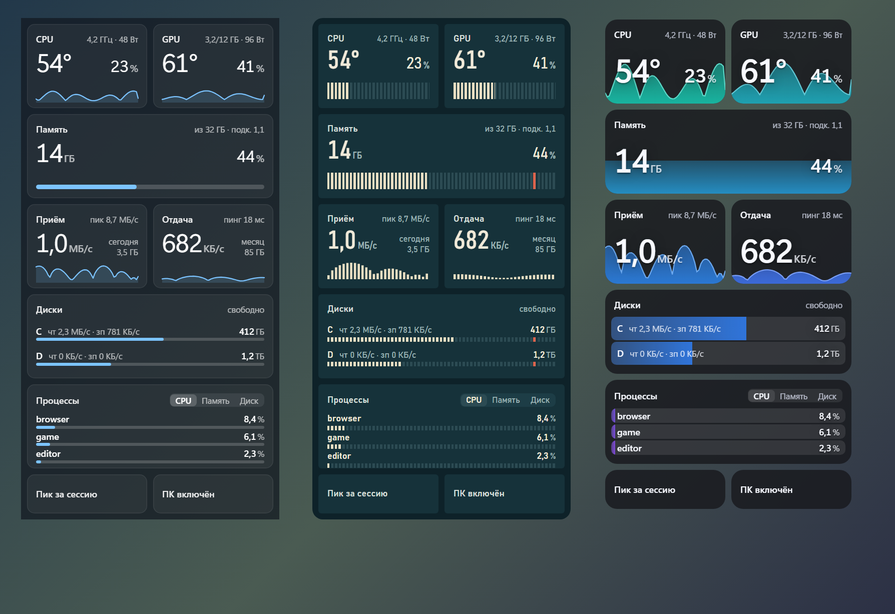
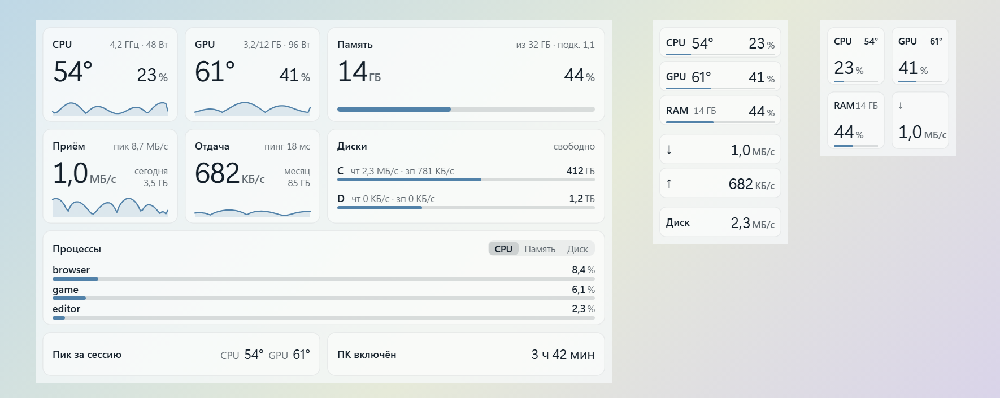
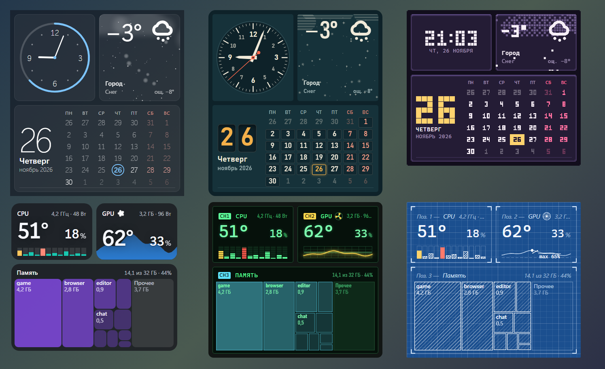
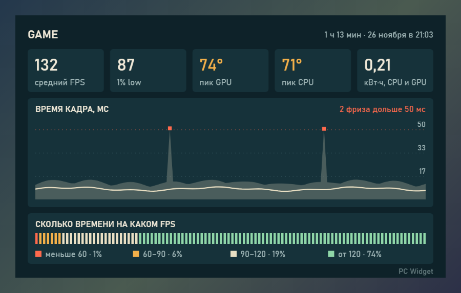

# PC Widget

[Русский](README.md) · **English**

**Version 1.3.2**

## [⬇ Download widget.exe](https://github.com/RockyRoketto/PCWidget/releases/latest/download/widget.exe)

Windows 10/11, 64-bit. [Requirements](#requirements) · [How to install](#installation) · [All releases](https://github.com/RockyRoketto/PCWidget/releases)

A Windows desktop widget showing CPU and GPU load and temperatures, memory, network, disks and processes. A single exe that lives in the tray; everything is configured from the widget itself.



> **Note:** the interface is currently in Russian only.

## Features

### What it shows

- **Tiles:** CPU, GPU, memory, network (speed, ping, daily and monthly traffic), disks, top processes, session peaks, uptime.
- **Optional:** clock, calendar, weather, energy, focus timer and Claude Code limits.
- **Energy:** CPU and GPU consumption in Wh per day and month, with the cost at your tariff. Other PC parts are not counted.
- **Focus:** a pomodoro timer with sound and a notification.
- **Alerts:** temperature and usage thresholds, optional Windows notifications.

### How it looks

- **Seven themes:** Sheet (glass), Gauge (segmented scales), Fill (color gradient), LCD (segmented digits), Oscilloscope, Blueprint, Pixels. Each comes in light, dark and "follow Windows". Any tile can have its own color.
- **Modes:** Panel, Wide, Column, Strip, Square. While dragged, the widget snaps to screen edges, screen center lines and window edges; only you change the mode.
- **Layout:** drag tiles with the mouse, hide them, make them half or full width; some can also be thin.
- **Profiles:** up to six appearance sets, transferable as a file.



### Clock, weather and tile details

- **Clock and calendar:** several faces matching each theme.
- **Weather:** now and for the week, with an animated background (can be turned off).
- **Optional:** per-thread CPU bars, a memory map by process and a GPU fan icon (in the settings of that tile).



### Games

- **Game mode:** FPS, 1% low and frame time over a windowed or borderless game (Ctrl+Shift+F). Nothing is injected into the game; exclusive fullscreen cannot be overlaid.
- **Game summary:** after a game, a card with FPS, 1% low, stutters, peak temperatures and energy used; it can be saved as an image.



### Extras

The widget sits on the desktop and survives Win+D, can be always on top, scales, and protects against screen burn-in.

*Screenshots show sample data and the Russian interface.*

## Requirements

- Windows 10 or 11, 64-bit
- WebView2 Runtime (preinstalled on Windows 11)
- .NET Framework 4 (preinstalled on Windows)
- The GPU tile needs an NVIDIA card with its driver. Without one the tile is hidden.
- Administrator rights: CPU sensors cannot be read without them.

## Installation

1. Download `widget.exe` from [Releases](../../releases) or build it yourself.
2. Run it. The file is not code-signed, so SmartScreen may warn you: choose "More info", then "Run anyway".
3. Confirm in the setup window. The program copies itself to `Program Files\PCWidget`, adds itself to the Start menu and to startup (a scheduled task) and starts; progress and the result are shown on screen. You can delete the downloaded file afterwards.

Autostart can be turned off in the settings. To run without installing, pass `--portable`.

## Updates

Shortly after start and every 6 hours the widget checks GitHub for a new version. If there is one, a blue update bar appears below the tiles: click it (or use **«Настройки → Система → О программе → Обновить»**) and confirm. The widget downloads the new version (progress is shown), verifies its checksum and restarts; settings are kept. Nothing is downloaded without your consent. The check can be turned off in the same place.

Moving from version 1.0 is manual, once: download `widget.exe` and run it.

### CPU temperature

CPU temperature, clock and power need the [PawnIO](https://pawnio.eu/) driver. The installer offers to set it up through `winget`; you can also do it later from the menu. Without the driver everything else works, those readings are simply absent.

## Uninstall

Use **«Настройки → Система → Удалить…»** (Settings → System → Remove), the menu item **«Удалить PC Widget…»** or "Apps & features" in Windows. Settings remain in `%APPDATA%\pcwidget` and the unpacked sensor libraries in `%LOCALAPPDATA%\pcwidget`; delete these folders by hand if you wish. The PawnIO driver is removed separately.

## Network and privacy

There is no telemetry. The widget only connects to:

| Where | Why | When |
|---|---|---|
| `1.1.1.1:443` | ping and packet loss (connection only, no data sent) | every 5 seconds |
| `api.github.com`, `github.com` | checking for a new version, and downloading it with your consent | after start and every 6 hours, can be turned off |
| `open-meteo.com` | weather for the city you type in | only while the weather tile is enabled |

**The Claude tile** is off by default. It reads local Claude Code files in `~/.claude` (logs, to count tokens, and the session list). It does not read your login token and makes no network requests. The button that connects usage limits adds a small mod to `~/.claude/skills/pcwidget-limits`; disconnecting or uninstalling the widget removes it.

## Building

You need Go (version as in `go.mod`) and PowerShell. CGO is not used.

```powershell
go install github.com/tc-hib/go-winres@latest
```

```powershell
./scripts/build.ps1
```

The script runs the tests, downloads the LibreHardwareMonitor release, adds the icon and manifest, and writes `dist/widget.exe`. Without `go-winres` the exe is built without them.

## How it works

Go without CGO, a custom Win32 window hosting WebView2. Once a second Go sends the readings to the page (HTML, CSS and JavaScript from `assets/`, all embedded in the exe). CPU sensors are read by a small C# helper, compiled on the machine with the built-in `csc.exe`, using LibreHardwareMonitorLib. The GPU is queried through `nvidia-smi`.

## License

[MIT](LICENSE). Third-party components and their licenses are listed in [THIRD-PARTY.md](THIRD-PARTY.md).

This is an independent project, not affiliated with Anthropic, NVIDIA, Microsoft, or the authors of LibreHardwareMonitor and PawnIO. All names belong to their owners.
