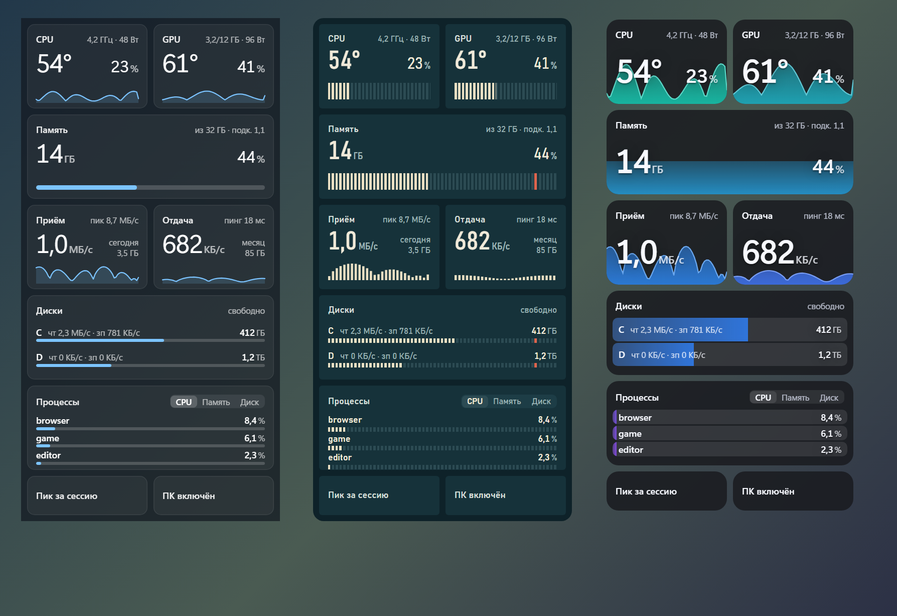
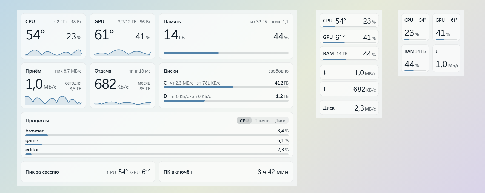
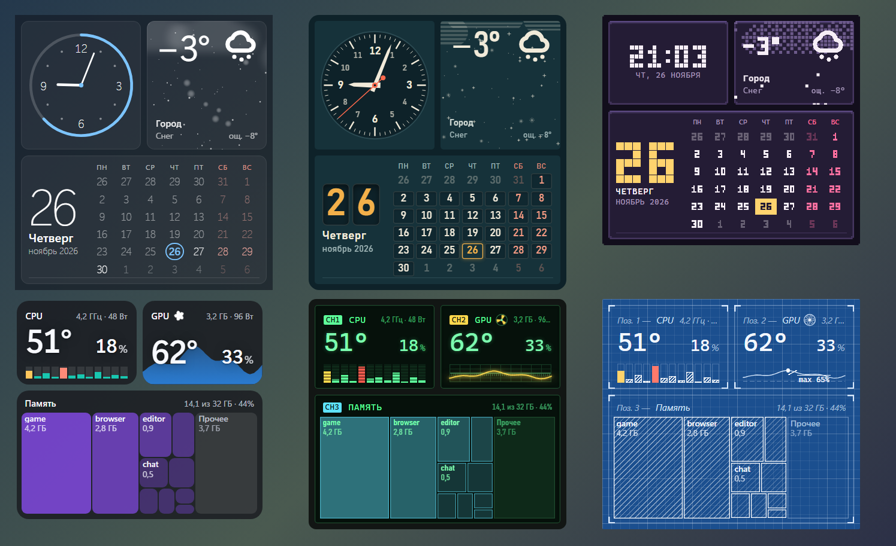
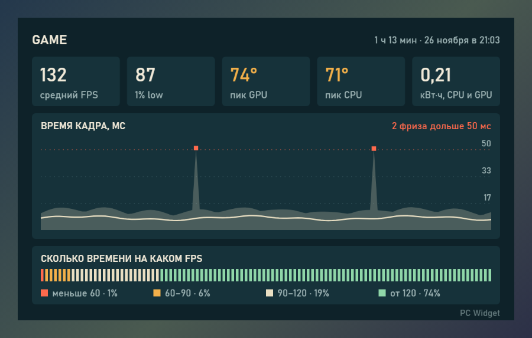

<div align="center">


# PC Widget

**Виджет на рабочий стол Windows: процессор, видеокарта, память, сеть и диски одним взглядом**

[](https://github.com/RockyRoketto/PCWidget/releases/latest)


### [⬇ Скачать widget.exe](https://github.com/RockyRoketto/PCWidget/releases/latest/download/widget.exe)

**Русский** · [English](README.en.md) · [Что нового](CHANGELOG.md)

</div>



Загрузка и температуры процессора и видеокарты, память, сеть, диски и процессы всегда на рабочем столе. Это один exe, который живёт в трее, а настраивается всё из самого виджета. Интерфейс на русском языке, на снимках примерные данные.

[Как начать](#как-начать) · [Что показывает](#что-показывает) · [Оформление](#оформление) · [Часы и погода](#часы-и-погода) · [Игры](#игры) · [Обновление и удаление](#обновление-и-удаление) · [Приватность](#сеть-и-приватность)

## Как начать

1. Скачай `widget.exe` и запусти (Windows 10 или 11, 64-бит). Если Windows пишет «Неизвестный издатель» (у exe нет цифровой подписи), нажми «Подробнее» → «Выполнить в любом случае».
2. Нажми «Установить». Программа скопируется в `Program Files\PCWidget`, появится в меню «Пуск», будет включаться вместе с Windows и сразу запустится. Ход установки и итог показаны на экране, скачанный файл потом можно удалить.
3. Для температуры, частоты и мощности процессора установщик предложит драйвер [PawnIO](https://pawnio.eu/) (ставится через `winget`, можно и позже из меню). Без него остальное работает, а этих показаний просто нет.

Настройки открываются правой кнопкой по виджету или по значку возле часов. Там же выключается автозапуск. Чтобы запустить без установки, добавь ключ `--portable`.

**Что нужно.** WebView2 Runtime (в Windows 11 уже есть), .NET Framework 4 (в Windows уже есть) и права администратора: без них не прочитать датчики процессора. Плитка GPU работает с видеокартами NVIDIA с драйвером, без неё на плитке написано «Нет данных».

## Возможности

### Что показывает

Только нужное: любую плитку можно включить, скрыть или переставить. Включённая плитка видна всегда: пока данных нет, на ней название и подсказка, например «Выбери город в настройках» или «Ничего не играет».

- CPU, GPU, память, сеть (скорость, пинг, трафик за день и месяц), диски, топ процессов, пики за сессию, время работы ПК.
- По желанию: часы, календарь, погода, энергия, фокус-таймер, «Сейчас играет», «Куда ушёл день» и лимиты Claude Code.
- **Сейчас играет:** то, что Windows показывает в системном окне громкости (браузеры и плееры): название, автор, обложка, ход трека и кнопки, которые разрешает источник. Если источников несколько, щелчок по имени переключает их. В Колонке, Полоске и Квадрате это строка, щелчок по ней ставит на паузу и пускает дальше.
- **Куда ушёл день:** сколько времени сегодня какая программа была на переднем плане. Названия обычные, а не имена exe (игры из Steam и Epic называются как в библиотеке), рядом значок программы. Без мыши и клавиатуры дольше 5 минут счёт останавливается, если на экране не идёт видео или игра на весь экран. В настройках плитки программе можно дать своё название.
- **Энергия:** расход процессора и видеокарты в Вт·ч за день и месяц, стоимость по твоему тарифу. Остальные части ПК не учитываются.
- **Фокус:** таймер помидоро со звуком и уведомлением.
- **Тревоги:** пороги температуры и заполнения, по желанию уведомления Windows.

### Оформление

Семь тем, у каждой светлый, тёмный вариант и «как в Windows».

- «Лист» (стекло), «Прибор» (шкалы с делениями), «Заливка» (цветной градиент), «ЖК-табло» (сегментные цифры), «Осциллограф», «Чертёж», «Пиксели». Свой цвет для любой плитки.
- Режимы: Панель, Широкая, Колонка, Полоска, Квадрат. Режим и размер выбираешь ты.
- Плитки перетаскиваются мышью, бывают в половину или во всю ширину, часть из них ещё и тонкими.
- Виджет прилипает к краям и середине экрана и к краям окон.
- До шести профилей оформления, перенос через файл.



Виджет лежит на рабочем столе и остаётся после Win+D, может быть поверх всех окон, меняет масштаб, есть защита от выгорания экрана.

### Часы и погода

- Часы и календарь: по несколько видов в стиле каждой темы.
- Погода: сейчас и на неделю, с анимированным фоном (отключается).
- По желанию: столбики загрузки по потокам CPU, карта памяти по процессам и значок вентилятора видеокарты (в настройках соответствующей плитки).



### Игры

- **Игровой режим:** FPS, 1% low и время кадра поверх игры в окне или в окне без рамки (Ctrl+Shift+F). Без внедрения в игру; эксклюзивный полный экран перекрыть нельзя.
- **Итог игры:** после игры карточка с FPS, 1% low, фризами, пиками температур и расходом энергии; её можно сохранить картинкой.



## Обновление и удаление

Виджет вскоре после запуска и раз в 6 часов проверяет, нет ли новой версии на GitHub. Если есть, над плитками появляется жёлтая полоса «Обновить до …»: нажми на неё (или «Настройки → Система → О программе → Обновить») и подтверди. Виджет скачает новую версию (ход загрузки виден в окне), сверит контрольную сумму и перезапустится; настройки сохранятся. Без твоего согласия ничего не скачивается. Проверку можно выключить там же.

Удалить: «Настройки → Система → Удалить…», пункт меню «Удалить PC Widget…» или «Приложения и возможности» в Windows. Настройки остаются в `%APPDATA%\pcwidget`, распакованные библиотеки датчиков в `%LOCALAPPDATA%\pcwidget`; эти папки можно удалить вручную. Драйвер PawnIO удаляется отдельно.

## Сеть и приватность

Телеметрии нет. В сеть виджет обращается только так:

| Куда | Зачем | Когда |
|---|---|---|
| `1.1.1.1:443` | пинг и потери (только соединение, данные не передаются) | раз в 5 секунд |
| `api.github.com`, `github.com` | проверка новой версии и её скачивание по твоему согласию | после запуска и раз в 6 часов, можно выключить |
| `open-meteo.com` | погода по названию города | только если включена плитка «Погода» |

**Плитка «Куда ушёл день»** по умолчанию выключена и считает только пока включена. Хранит на этом ПК названия программ, их значки и секунды за сегодня (`%APPDATA%\pcwidget\day.json`); заголовки окон и сайты не записываются, в сеть эти данные не уходят.

**Плитка Claude** по умолчанию выключена. Она читает локальные файлы Claude Code в `~/.claude` (журналы, чтобы считать токены, и список сессий). Токен входа не читается, в сеть плитка не ходит. Кнопка «Подключить лимиты» добавляет небольшой мод в `~/.claude/skills/pcwidget-limits`; кнопка «Отключить» или удаление виджета его убирают.

## Для разработчиков

Один exe на Go без CGO: собственное Win32-окно с WebView2. Раз в секунду Go отправляет показатели в страницу (HTML, CSS, JavaScript из `assets/`, всё вшито в exe). Температуры CPU читает маленький помощник на C#, который собирается на месте штатным `csc.exe` и использует LibreHardwareMonitorLib. Видеокарту опрашивает `nvidia-smi`.

Нужны Go (версия из `go.mod`) и PowerShell.

```powershell
go install github.com/tc-hib/go-winres@latest
```

```powershell
./scripts/build.ps1
```

Скрипт запускает тесты, скачивает релиз LibreHardwareMonitor, добавляет иконку с манифестом и кладёт результат в `dist/widget.exe`. Без `go-winres` exe соберётся без иконки и манифеста.

Лицензия [MIT](LICENSE). Сторонние компоненты и их лицензии перечислены в [THIRD-PARTY.md](THIRD-PARTY.md). Проект независимый и не связан с Anthropic, NVIDIA, Microsoft и авторами LibreHardwareMonitor и PawnIO. Названия принадлежат их владельцам.

---

<div align="center">

© RockyRoketto

</div>
